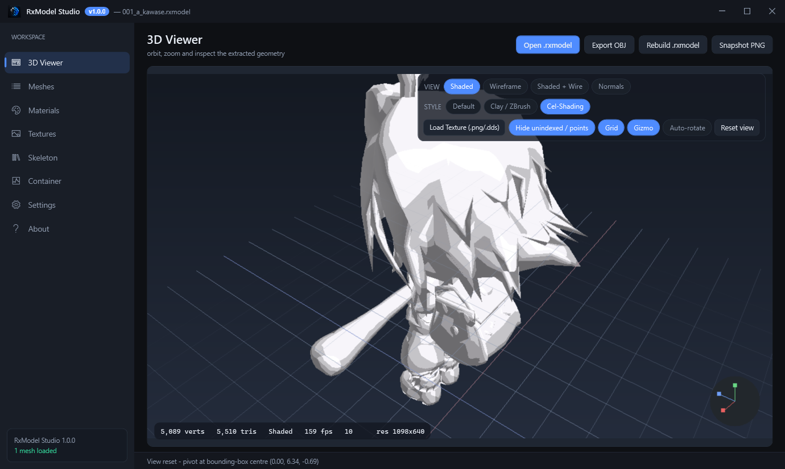
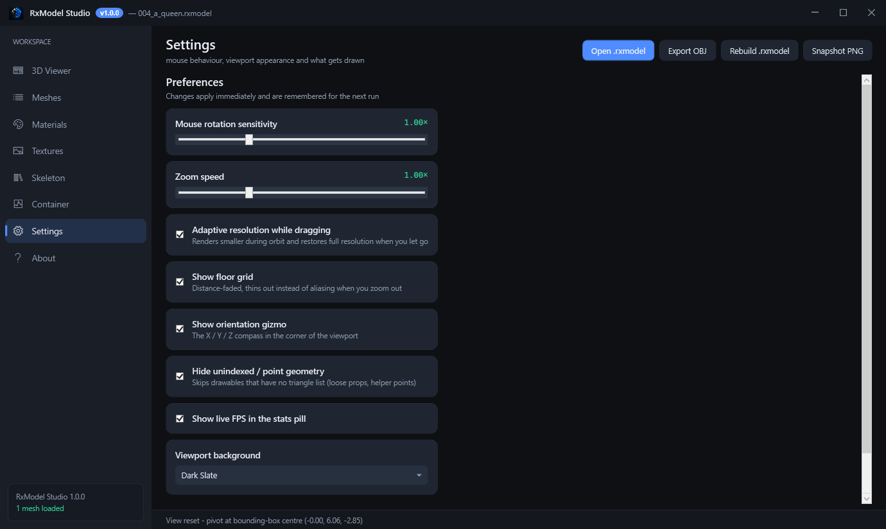
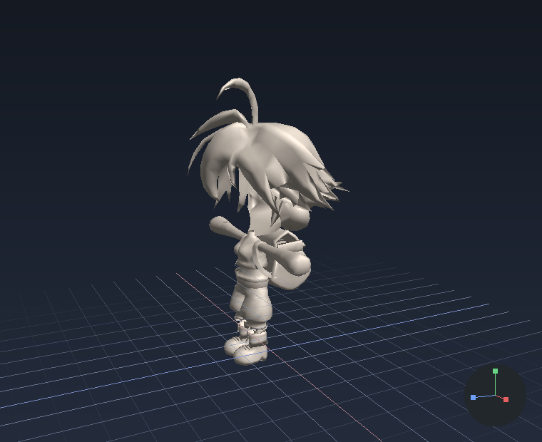
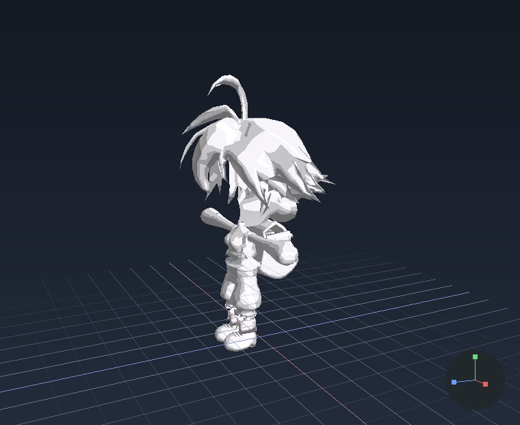
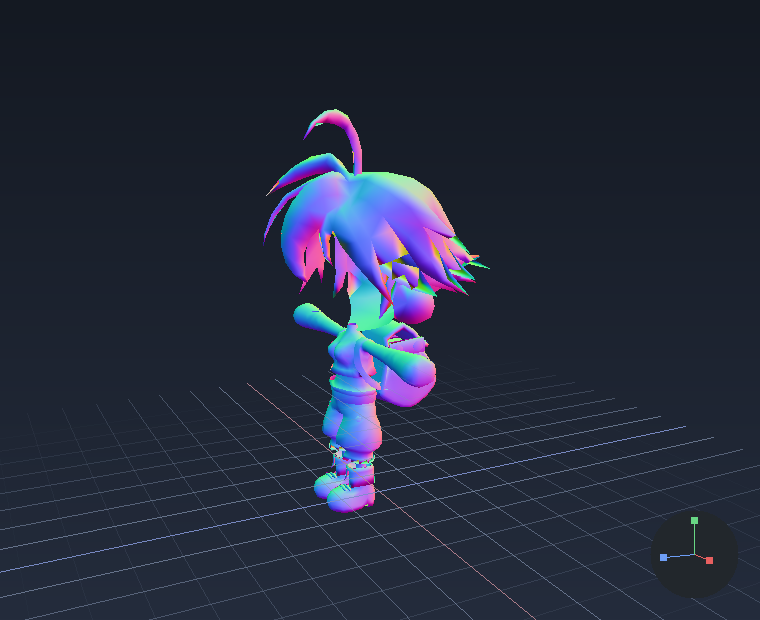
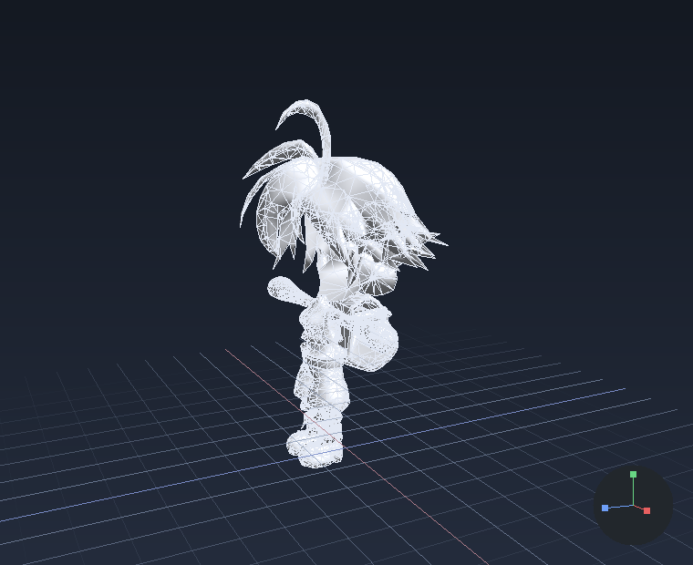
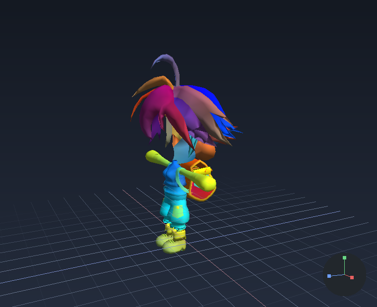

# RxModel Studio

**Version 1.0.0** · Windows 64-bit · Single file, no installation

<p>
  
  
  
  
</p>

A viewer, extractor and converter for the 3D character models used by **Studio
Saizensen** games built on the rrlib / OpenDraw engine — most notably
**Umihara Kawase BaZooKa!**.

Open a model, spin it around with the mouse, look at its meshes, bones and
materials, export it as `.obj` for Blender, and write the file back out again.
Everything happens in one window, from one `.exe`.



---

## Download

Go to **[Releases](../../releases/latest)** and download `RxModelTool.exe`
(about 60 MB). That single file *is* the whole program — there is nothing to
install, no setup wizard, no additional runtime, and it never needs an internet
connection.

> **Windows SmartScreen:** because the file is unsigned, the first launch may show
> *"Windows protected your PC"*. Choose **More info → Run anyway**.

---

## What you can do with it

| | |
|---|---|
| **Look at the model** | Full 3D viewport with orbit, zoom and pan, running on a built-in renderer that needs no graphics-card features |
| **Inspect the breakdown** | Mesh list with a rendered thumbnail for each one, materials, textures, and the complete skeleton with every joint |
| **Export for other tools** | Wavefront `.obj` + `.mtl` per mesh — opens straight in Blender, Substance Painter, Marmoset, Windows 3D Viewer |
| **Save an image** | One-click PNG snapshot of the viewport |
| **Bring your own texture** | Load a `.png` / `.jpg` / `.dds` and it is mapped onto the model through its own UV coordinates |
| **Write the file back** | Rebuild the archive and save it — unchanged files come out byte-for-byte identical |
| **Different looks** | Shaded, wireframe, both, normal-map view, plus Clay/ZBrush and Cel-shading styles |

---

## Getting started

1. Run `RxModelTool.exe`.
2. Press **Open .rxmodel** and pick a model file.
3. Drag with the left mouse button to rotate, scroll to zoom, right-drag to pan,
   double-click to re-frame.
4. Use **Export OBJ** when you want the model somewhere else.

If you drop a matching image next to the model file (same name, `.png` or `.dds`),
the texture is picked up automatically.

---

## The pages

| Page | What is on it |
|---|---|
| **3D Viewer** | The viewport, render modes, shading styles, texture loading |
| **Meshes** | A card per mesh: live thumbnail, vertex and triangle counts, bounding-box size, isolate button |
| **Materials** | Every material slot with its shading values and the texture it points at |
| **Textures** | The image files the model asks for, with their filtering and wrapping settings |
| **Skeleton** | All joints, their bind-pose position and matrix |
| **Diagnostics** | A read-out of the loaded file, useful when reporting a problem |
| **Settings** | Mouse sensitivity, zoom speed, adaptive resolution, grid, gizmo, viewport colour, FPS display |
| **About** | Version, credits and links |



---

## Shading styles

| Default | Clay / ZBrush | Cel-Shading | Normals |
|---|---|---|---|
| Soft three-point studio lighting | Matte warm clay with a tight highlight — best for reading the sculpt | Hard banded anime lighting with a rim step | Surface direction painted as colour, to check the normals at a glance |
|  |  |  |  |

There is also a pure **wireframe** mode and a **shaded + wireframe** overlay:



And textures are supported — this one is a test chart to show the UV mapping:



---

## Settings

Everything applies instantly and is remembered for the next run. Settings are stored
in `%APPDATA%\RxModelStudio\`, never next to the `.exe`, so a read-only USB stick or a
locked folder is not a problem.

* Mouse rotation sensitivity and zoom speed
* **Adaptive resolution** — renders lighter while you drag and restores full quality
  the moment you let go, which keeps orbiting fluid on the heavier models
* Floor grid (it thins and fades itself out as you zoom away, so it never shimmers)
* Orientation gizmo
* Hide point-only geometry
* Viewport background: Dark Slate / Charcoal / Neutral Grey / Deep Blue
* Live FPS display

---

## Performance

Measured on the shipped build, at a 1120 × 760 viewport, with grid and gizmo on:

| Model | Vertices | Triangles | Frames per second |
|---|---|---|---|
| Character A | 5,089 | 5,510 | 131 |
| Character B | 6,369 | 6,058 | 73 |
| Character C | 4,336 | 3,702 | 284 |
| Character D | 4,688 | 6,846 | 220 |
| Character E | 5,789 | 5,642 | 301 |

Adaptive resolution pushes the numbers during interaction higher still.

---

## Requirements

* 64-bit **Windows 10 or 11**
* ~120 MB of free disk while running (it unpacks itself to a temporary folder)
* No .NET installation, no Visual C++ redistributable, no admin rights needed

---

## Known limitations

* **Textures are not extracted from the game.** The models reference image files in a
  proprietary container that this tool cannot decode, so models appear untextured until
  you supply a `.png` or `.dds` yourself with **Load Texture**.
* Meshes are exported one block per drawable; faces are not yet split into separate
  groups per material.
* One small decorative piece in one of the characters has no triangle list, so it is
  hidden by default. Turn *Hide unindexed / point geometry* off if you want to see it.
* Animations are not read — only the bind pose.

---

## If something goes wrong

The program never closes silently. Any unexpected error is written with full details to

```
%APPDATA%\RxModelStudio\crash.log
```

and a dialog tells you the file was created. Attach that log when reporting a problem —
**Settings → Open crash.log folder** gets you there in one click.

---

## FAQ

**Does it work with other games?**
It is built for the model format used by this studio's engine. Other games using the
same engine may work; unrelated `.rxmodel` files from other developers will not.

**Will editing and rebuilding break the game?**
Rebuilding without changes reproduces the original file exactly. If you replace data
inside the file, test your own backups first.

**Why is the file 60 MB?**
It carries its entire runtime inside itself so you never have to install anything.

**Does it phone home?**
No. It has no network code, and links only open when you click them.

---

## Credits and contact

**RxModel Studio v1.0.0** — developed by **Amin Mohebbi (mohebbi)**

| | |
|---|---|
| GitHub | [mohebbiamin](https://github.com/mohebbiamin) |
| ResHax | [mohebbi](https://reshax.com/profile/11716-mohebbi/) |
| Telegram | [@Amin_o0x](https://t.me/Amin_o0x) |

Bug reports, model files that refuse to open, and feature requests are welcome on the
issues page or on Telegram.

---

## A note about this repository

This repository publishes **the tool**, not a specification. The internal layout of the
files it reads is deliberately undocumented here — please don't ask for it, and please
don't reverse the binary to get it. If you want a feature added, open an issue instead.

The binary is provided as-is, for modding and personal use. Respect the rights of the
original developers of the games these files come from.

---
